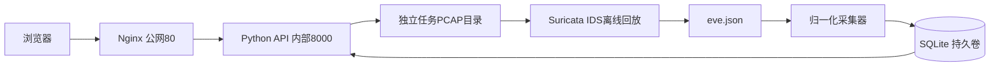

# 金睛云华 · 流量威胁检测系统

基于 Suricata 的离线 PCAP 检测与告警研判系统。当前已跑通真实检测；这是持续完善中的赛题作品，不是生产部署。

## 快速开始（Ubuntu）

准备 Docker Engine、Compose（支持 --wait）、git、python3、make 和可用镜像源；私有 GitHub 仓库需读取权限。

```sh
git clone git@github.com:Z26C03Y25/Jinjing-Yunhua-Test.git
cd Jinjing-Yunhua-Test
make up
```

首次初始化自动生成 .env 中的分析员/只读密码，终端显示一次；已有 .env 不覆盖。初次构建需要下载 Debian 和 Nginx 镜像及系统包。使用中科大 Debian 镜像；网络受限时可先通过 DaoCloud 拉取基础镜像再打回原标签。干净环境启动耗时尚未实测，不声明已达到十五分钟。

浏览器访问服务器 HTTP 80。只发布业务端口 80，内部后端 8000 不对外开放。SSH 仅用于运维。宿主机已有 Nginx 占用 80 时需先协调端口。

## Windows 开发部署

```bat
scripts\sync-remote.cmd -Deploy
```

中文交互输入 IP 和统一密码（适用于本地密钥口令与服务器密码相同），默认 root。Git 作者信息缺失时提示填写。同步到 ~/code/Jinjing-Yunhua-Test，首次克隆、以后快进拉取；服务器使用专用只读 Deploy key。脚本按 Git 提交标签构建后端，成功后下架旧容器并启动，核验健康和运行版本；不删除数据卷，不强制覆盖远程修改。基础镜像需提前准备。首次初始化可在 Ubuntu 运行 make up，后续通常只需此 Windows 命令。

## 架构



前端只读 API，不直接读取引擎输出。后端非 root 运行，未挂载 Docker socket。每任务记录原始事件及规则快照，避免不同回放相互污染。

## 功能与自验

- 上传经典 PCAP，任务状态、错误信息、真实告警。
- 列表筛选、排序、分页、处置审计，详情规则与关联事件。
- 总览统计、规则启停、只读角色、保留原始证据的固定时间桶聚合。
- 四类攻击线索、自建生成脚本、正常样本和两个变异场景。

```sh
make test
make validate
make down
```

validate 会启动环境，再询问分析员密码，回放全部样本，输出 validation/report.json 和 report.md。当前实际结果：六项期望命中、一项慢扫 FN；两个正常样本无告警。详见 docs/自验报告.md，不把样本精确率扩大为未知流量检出能力。

## 设计取舍与已知缺陷

SQLite 降低部署复杂度，单 worker 和四项队列限制引擎资源；不适合高并发。Suricata 与 API 同镜像避免 Docker socket 风险，代价是系统依赖构建。规则是可疑行为特征，不证明入侵成功。

仍需完善：页面视觉与图表、首攻击包至入库时延、业务聚合去重率汇入报告、依赖漏洞审计、磁盘配额、登录限流、清洁环境复验。只暴露 HTTP 80 的演示环境不提供传输加密。正常样本 DNS 仅查询，TLS 仅 ClientHello。具体安全审查见 agent-log/review.md。最终录屏和实际工时不得伪造。

目录沿用题面：rules、backend、frontend、data、validation、agent-log、docs；开发关键提交与真实错误记录保留。初始化脚本尚待远程空环境验证，不能将既有环境的成功当作全新环境验证。
